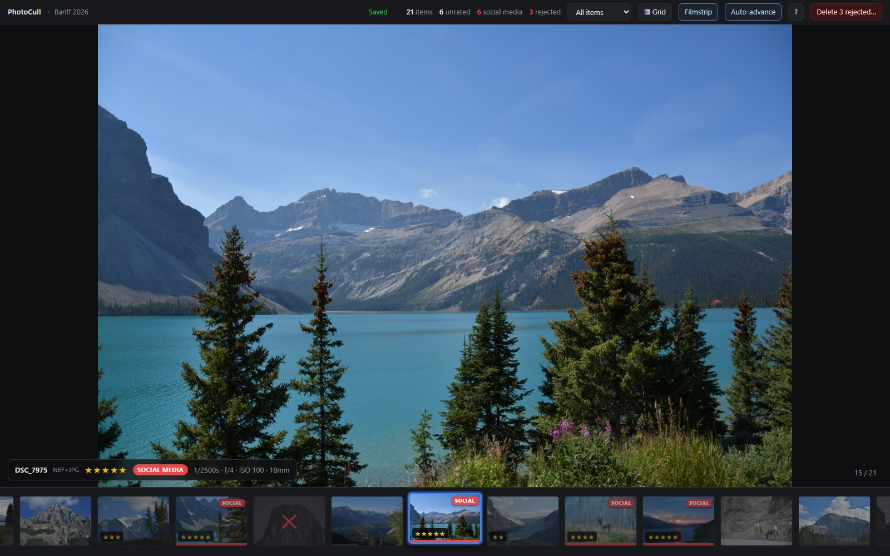
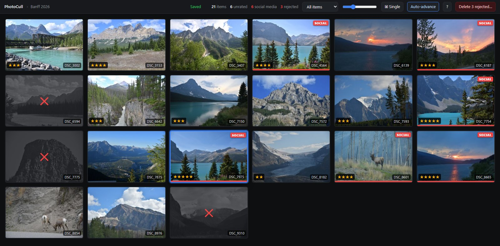
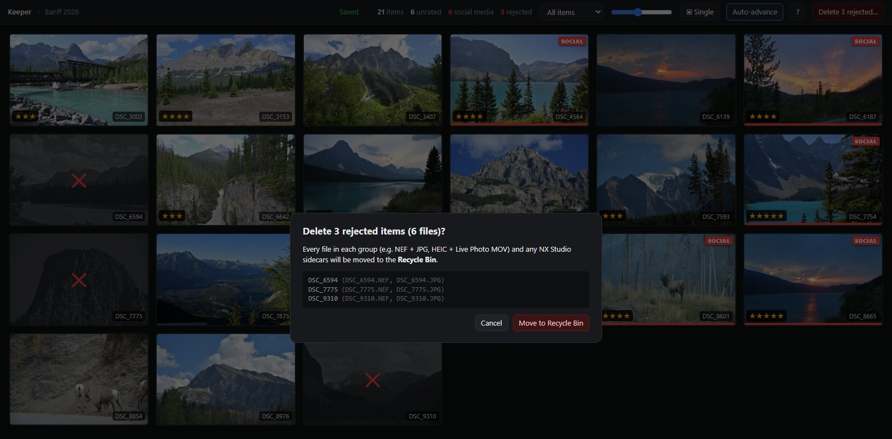
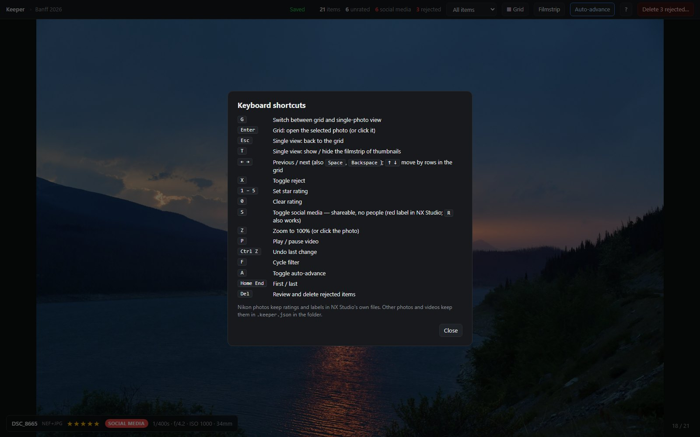

<h1 align="center">Keeper</h1>

<p align="center">
  <b>Cull a thousand photos in minutes, from the keyboard.</b><br>
  Rate, label and reject Nikon NEF+JPG pairs, phone photos and videos, then clear out the rejects in one go.
</p>

<p align="center">
  
  
  
  
</p>



## Why Keeper

**⚡ Built for speed.** One key per decision: `1`–`5` to rate, `X` to reject,
`S` to flag for social media. Keeper jumps to the next photo and preloads
the ones after it, so a whole card is done before your coffee cools.

**🔗 Plays nicely with NX Studio.** Ratings and labels go into NX Studio's own
sidecar files, so when you open the folder in NX Studio for editing, your
picks are already there. NEF+JPG pairs are always treated as one photo.

**🛡️ Your originals are never touched.** Keeper only *reads* your photos.
Everything it records lives in sidecars or a small `.keeper.json`, and
deleting is a deliberate, reviewed step that goes to the Recycle Bin.

**📱 Not just Nikon.** Phone photos (including iPhone HEIC and Live Photos),
other cameras' raw files and videos all work too.

### See the whole shoot at once

Switch to the grid (`G`) to scan a folder at a glance. Stars, social-media
picks and rejects show on every thumbnail; click a photo to select it and click again to open it full size.



### Delete with confidence

Rejects aren't deleted as you go. When you're ready, press `Del` to review
exactly which files will go, then send every file of each photo (NEF, JPG,
Live Photo video and NX Studio sidecars) to the Recycle Bin together.



### Everything is a keystroke away

Press `?` any time for the full list of shortcuts.



## Quick start: portable exe (nothing to install)

`Keeper.exe` is a single file with Python and everything else built in.
Download it from the repo's
**[Releases page](https://github.com/AbhinavA10/Keeper/releases/latest)**
(under *Assets*), copy it anywhere (Desktop, USB stick, another PC) and:

* **double-click it**, or
* **drag a folder onto it**.

A console window opens, scans the folder, and opens Keeper in your default
browser. Keep the console window open while you work; **close it to quit**.

Use **📁 Open folder…** in the header (or press **O**) to switch folders at any
time. Keeper remembers the last folder and reopens it next time. If that
folder is gone (e.g. an unplugged drive), it opens your Pictures folder
instead and says so.

Requirements on the machine: **Windows 10 or 11** and a modern browser
(Chrome, Edge or Firefox). Optionally **[ffmpeg](https://ffmpeg.org/download.html)**
on the `PATH` for video thumbnails; videos still play without it.

To make one from the current code instead,
[build it](#build-the-portable-exe) (a minute or so). The first launch takes a few seconds while Windows
unpacks it; Windows SmartScreen may ask you to confirm the first time because
the exe isn't code-signed (*More info → Run anyway*).

## Install from source (for running or building)

You need **Windows 10 or 11** and **Anaconda or Miniconda**. Clone the repo and
create the `keeper` conda environment from `environment.yml` (Python,
Pillow, pillow-heif for iPhone HEIC photos, and PyInstaller for building the exe):

```bash
git clone https://github.com/AbhinavA10/Keeper.git
```

(or `git clone git@github.com:AbhinavA10/Keeper.git` if you use SSH keys with GitHub)

```bash
cd Keeper
```

```bash
conda env create -f environment.yml
```

This takes about a minute. If it fails with a certificate or HTTP 429 error, see
[Troubleshooting](#troubleshooting).

After `environment.yml` changes, update the environment with:

```bash
conda env update -f environment.yml --prune
```

### Run from source

* **Double-click `Keeper.bat`** (reopens the last folder), or
* **drag a folder onto `Keeper.bat`**.

`Keeper.bat` uses the `keeper` conda environment (from Miniconda or
Anaconda in your user folder). To use a different Python, set
`KEEPER_PYTHON` to its `python.exe`.

### Build the portable exe

```bash
conda run --no-capture-output -n keeper pyinstaller keeper.spec --noconfirm --clean
```

The result is `dist\Keeper.exe` (about 20 MB), built from `keeper.spec`
with the icon in `assets\`. Rebuild it after changing any `.py` or `.html` file.
`dist\` and `build\` are ignored by git.

### Run the tests

```bash
conda run --no-capture-output -n keeper python -m unittest discover -s tests
```

They take a few seconds and use small fake photos made on the fly, in
temporary folders. They check what matters most: NX Studio sidecars get the
right rating and label while everything else in them (NX Studio's edits
included) stays byte for byte the same, and **no test operation ever
changes a photo or video file**. They also cover grouping, `.keeper.json`,
Fix dates, the remembered folder and the web API. Run them before publishing
a release.

### Publish a release

The exe isn't committed: each 20 MB build would stay in the repo's history
forever. GitHub Releases hold it instead. To publish one, bump `VERSION` at
the top of `keeper.py`, commit and push, then run:

```bash
conda run --no-capture-output -n keeper python release.py
```

It checks that everything is committed and pushed, builds the exe, tags the
commit (e.g. `v1.0.1`), and creates the release with the exe attached and
notes generated from the commits. This needs the [GitHub CLI](https://cli.github.com/)
(`gh`), signed in with `gh auth login`. `python release.py --build` only builds.

## Command line

The exe and the script take the same arguments:

```bash
Keeper.exe "M:\all\Pics-2sort-AB\101D7500"
```

```bash
conda run --no-capture-output -n keeper python keeper.py "M:\all\Pics-2sort-AB\101D7500"
```

(`--no-capture-output` matters: without it, `conda run` holds back all of
Keeper's messages, including the URL to open, until you quit.)

| Option | Effect |
|---|---|
| *(no folder)* | Reopens the last folder used, or your Pictures folder if it's not available |
| `--port=8765` | Use this port (default 47615, or any free port if that's taken) |
| `--no-browser` | Don't open the browser automatically (the URL is printed) |

The page itself also accepts a starting state in its URL, handy for bookmarks:
`?view=grid` or `?view=single`, `&strip=1` (show the filmstrip),
`&item=DSC_1234` (open that photo), `&filter=r1,r2,keep` (filter options,
comma-separated: `r0`–`r5` for unrated to 5★, `keep`, `rejected`, `red`, `blue`,
`nolabel`, `photos`, `videos`; `unrated` means `r0,keep`) and `&help=1` (show the shortcuts).

## Using it

There are two views. **Single view** shows one large photo; press **T** or the
*Filmstrip* button to show a strip of thumbnails underneath, where the current
photo is lifted and outlined in blue. **Grid view**
(press **G** or the *Grid* button) fills the window with thumbnails; drag the
slider in the header to resize them, click a photo to select it, and click it again (or press Enter) to open it. Rating,
labelling and rejecting work in both views.

In single view, ← → step over rejected photos so you only see what's left.
To look at a rejected photo again, open it from the grid (or filter for
*Rejected*). It shows a yellow **⚑ REJECTED** flag in the info card.

**Filter** (the button in the header, or **Shift+F**) shows only what you
tick. Options are grouped: *Stars* (Unrated, ★1–★5), *Status* (Not rejected,
Rejected), *Label* (Social media, Flagged, No label) and *Type* (Photos,
Videos). Ticks in the same group are alternatives, so ★1 + ★2 shows 1- and
2-star photos; ticks in different groups must all match, so adding *Not
rejected* hides rejected ones among them. Each option shows how many photos it
matches; *Show all* clears the filter.

Before culling a folder in Keeper, **close NX Studio** (or refresh its folder
view afterwards). Otherwise NX Studio can overwrite the new ratings from its cache.


| Key | Action |
|---|---|
| O | Open another folder (remembered for next time) |
| B | Show / hide the folder sidebar |
| G | Switch between grid and single-photo view |
| Click | Grid: select a photo; click it again to open it in single view |
| Enter | Grid: open the selected photo in single view |
| Esc | Single view: back to the grid |
| T | Single view: show / hide the filmstrip |
| C | Compare the photo's burst side by side (see [Compare bursts](#compare-bursts)) |
| ← → / Backspace | Previous / next (↑ ↓ move by rows in the grid). Single view skips rejected photos |
| X | Toggle reject |
| 1–5, 0 | Set / clear stars |
| S (or R) | Toggle social media: shareable, no people (stored as the Red label, 1, in NX Studio) |
| F | Toggle flagged: needs more correction in NX Studio (stored as the Blue label, 5). A photo has one label, so this replaces social media |
| Space | Play / pause a video; zoom a photo to 100% and back (in compare: zoom all frames) |
| Z or click | Zoom to 100% |
| P | Play / pause video |
| Ctrl+Z | Undo |
| Shift+F | Open / close the filter |
| A | Toggle auto-advance to the next photo after rating or rejecting |
| Home / End | First / last |
| Del | Review and move rejected items to the Recycle Bin |
| ? | Show these shortcuts |

The header shows **Saving… / Saved**. Wait for *Saved* before closing the
browser tab; it warns you if a save is still in progress.

### Compare bursts

Photos taken within 2 seconds of each other are grouped as a **burst** and
marked **⧉ 2/5** on their thumbnails. Press **C** (or **⧉ Compare**) to see the
whole burst side by side, then pick the best frame:

* **← →** select a frame (**↑ ↓** move by rows); rate, label or reject it with
  the usual keys.
* **K** keeps the selected frame and rejects every other frame of the burst
  (one **Ctrl+Z** undoes it all). With auto-advance on, the next burst opens.
* **Z** or double-click zooms all frames to 100% at the same spot; drag to pan
  them together, to compare focus and detail.
* **[ ]** go to the previous / next burst; **Esc** or **C** returns to where you were.

For a photo that isn't part of a burst, **C** compares it with the next photo.
Capture times are read in the background when a folder opens (a few seconds
for 1,000 photos), so burst badges can appear shortly after the thumbnails.

### Folder sidebar

Press **B** (or **☰**) for a sidebar listing the folders next to the open one,
each with how many photos it still has to sort (no stars, label or reject
yet). A green **✓** means the folder is done. Click a folder to open it, click
**▸** to see its subfolders, and **↑** to go up a level. *Recent* lists the
folders you've opened lately. The open folder's count updates as you work.

The counts come from NX Studio sidecars and `.keeper.json` only, so even
folders with thousands of photos are counted in a second or two. (Ratings set
in the camera itself only show up once a folder is opened.)

### Fix dates

**🕒 Fix dates…** sets the *Date Modified* of every JPEG in the folder to its
*Date Taken*, so files sort by when they were shot (handy after exporting from
NX Studio, which stamps exports with the export time). Date Taken comes from
the JPEG's EXIF, or from its NEF if the JPEG has none. You see how many will
change, already match, or have no Date Taken before anything happens. Only the
file system timestamp changes; the photo's contents are never touched.

### What counts as one item

Files with the same base name are one item and are deleted together:
`DSC_1234.NEF + .JPG`, `IMG_1234.HEIC + .MOV` (Live Photo), `IMG_1234.JPG + .AAE`,
`photo.DNG + photo.JPG`, `photo.JPG.xmp`. A video with no matching photo is its own item.

Previews: JPEG/PNG/WebP/GIF are shown directly. Raw files without a JPEG use
the camera's embedded preview. Videos play in the browser; some codecs (e.g.
HEVC in Chrome) can't play there, but they can still be culled.

### Where ratings, labels and rejects are stored

* **Nikon items** (NEF/NRW, anything that already has an NX Studio sidecar,
  out-of-camera Nikon JPEGs): ratings and labels go into NX Studio sidecars in
  `NKSC_PARAM\` next to the photos, one per file (`DSC_1234.NEF.nksc`,
  `DSC_1234.JPG.nksc`). Existing sidecars are updated; missing ones (and the
  folder) are created in NX Studio's own format. NX Studio 1.9 shows them as
  normal ratings and colour labels.
* **Everything else** (phone photos, videos): ratings and labels are kept in
  `.keeper.json` in the photo folder.
* **Rejects** are always kept in `.keeper.json`, so they never appear in NX Studio.
* Keeper was previously called PhotoCull. Folders culled with it keep their
  rejects: the old `.photocull.json` is read and replaced by `.keeper.json`
  the next time anything changes.

## Troubleshooting

| Problem | Fix |
|---|---|
| `Could not find the "keeper" conda environment` | Run `conda env create -f environment.yml`, or use `Keeper.exe`. |
| `conda env create` fails with `CERTIFICATE_VERIFY_FAILED` | Antivirus or a proxy is inspecting HTTPS. In the same terminal, first run `set CONDA_SSL_VERIFY=truststore` (Command Prompt) or `$env:CONDA_SSL_VERIFY="truststore"` (PowerShell), so conda uses the Windows certificate store. |
| `conda env create` fails with `HTTP 429` / "requires conda client registration" | Anaconda's `defaults` channel is blocked on your network. `environment.yml` already uses only conda-forge; make sure you're using the repo's copy. |
| Windows or antivirus blocks `Keeper.exe` | Unsigned PyInstaller exes are sometimes flagged. Allow it, or run from source with `Keeper.bat`. |
| HEIC photos show "No preview" | Running from an old environment: `conda env update -f environment.yml --prune`. |
| Video thumbnails are blank | Install ffmpeg and make sure `ffmpeg` runs from a new terminal. |
| Pages sometimes take a few seconds to load, or show "Failed to fetch" | Antivirus web protection (e.g. AVG/Avast Web Shield) can scan Keeper's local traffic and stall or reset it. Keeper retries automatically; if it keeps happening, add an exception for `127.0.0.1` in the antivirus settings. |
| A rejected item fails to delete | The file is open in another program (e.g. NX Studio). Close it and press **Del** again. |
| Ratings don't show in NX Studio | Refresh the folder in NX Studio, or close and reopen it. |

Previews and thumbnails are cached in `%LOCALAPPDATA%\Keeper`. It's safe
to delete that folder at any time; it is rebuilt as needed. The last folder
used is remembered in `%APPDATA%\Keeper\settings.json`.

## Project layout

| File | Purpose |
|---|---|
| `Keeper.bat` | Runs the app from source with the `keeper` conda environment |
| `keeper.py` | Local web server, folder scanning, grouping, Recycle Bin deletes |
| `keeper.html` | The browser UI |
| `xmp_rating.py` | Reading and writing NX Studio sidecars (`.nksc`) |
| `media.py` | File types, previews (HEIC, raw, video) and thumbnails |
| `environment.yml` | Conda environment (runtime + build tools) |
| `keeper.spec`, `assets\keeper.ico` | PyInstaller build of `Keeper.exe` and its icon |
| `release.py` | Builds `Keeper.exe` and publishes it as a GitHub release |
| `tests\` | Automated tests (`unittest`, no extra packages) |
